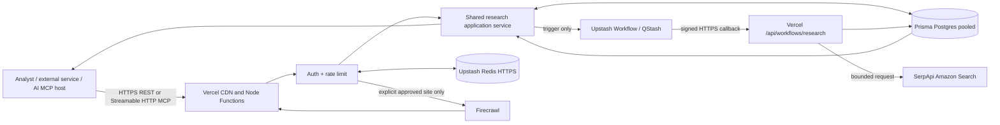
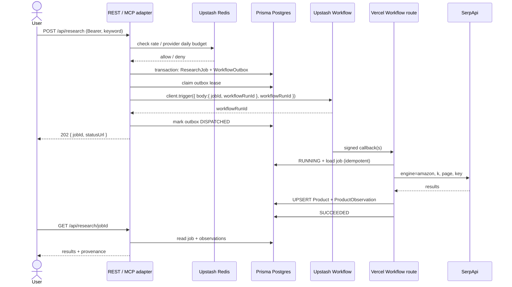
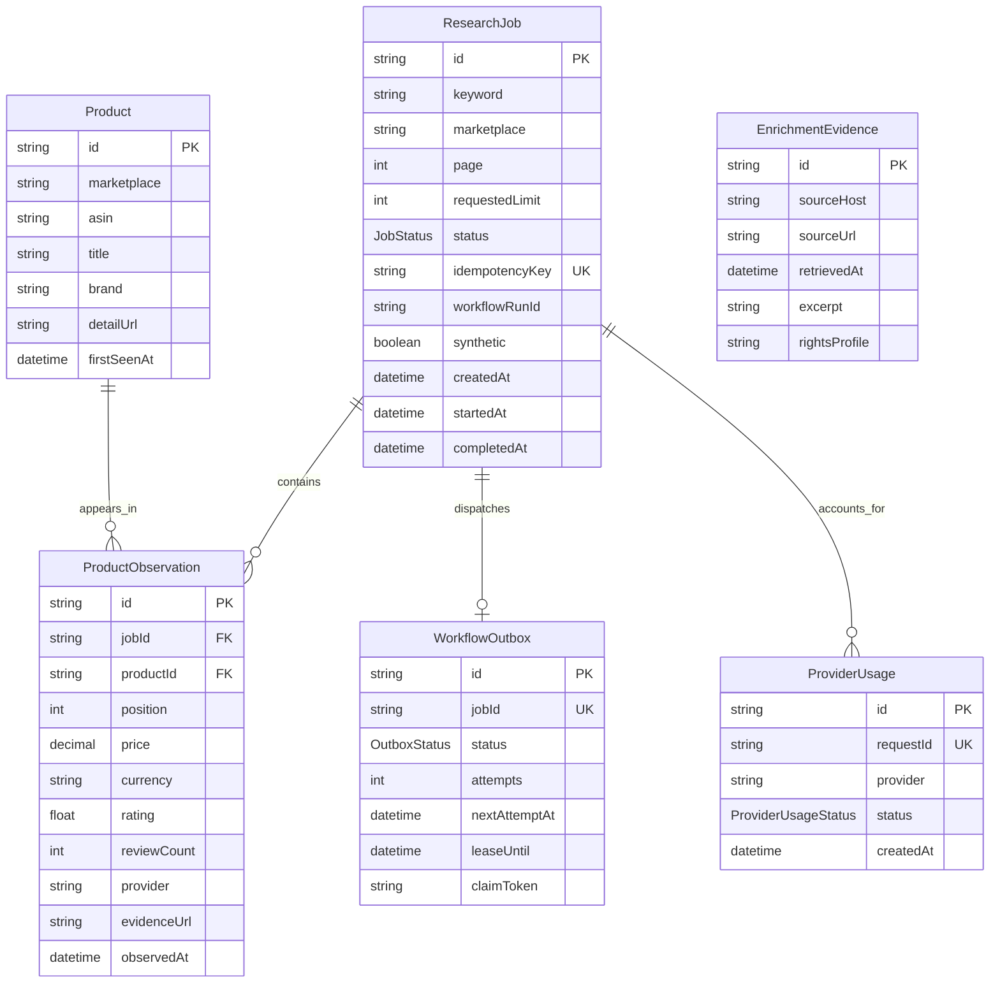
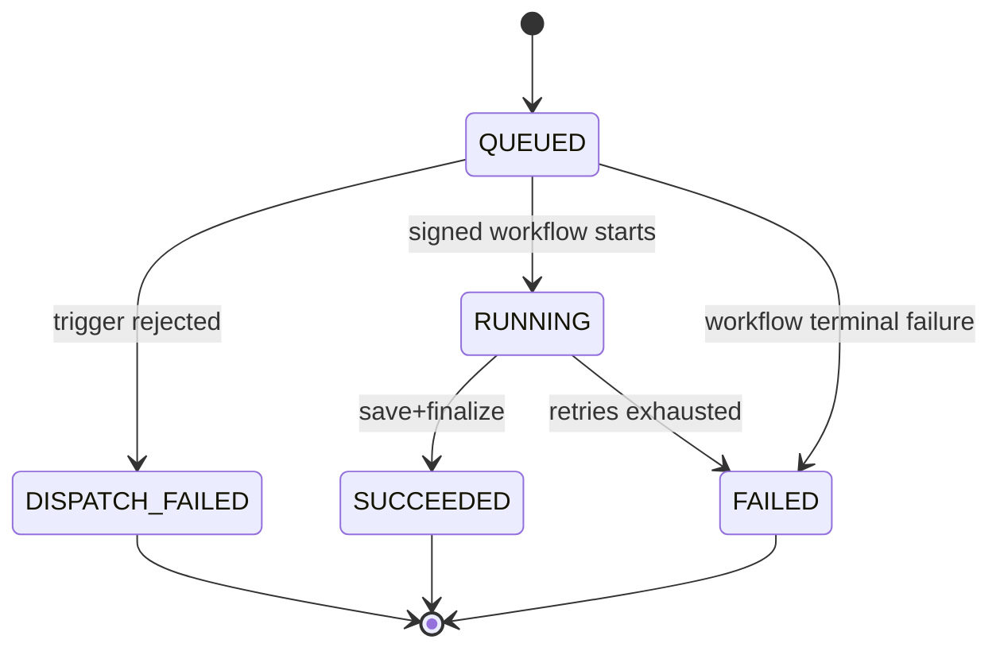

# Amazon Market Intelligence - Technical Architecture

**Version:** 2.1 | **Updated:** 2026-10-15 | **Deployment target:** Vercel serverless; release pending external provisioning | **Authority:** [spec.md](./spec.md) | **Runbook:** [guide.md](./guide.md)

## 1. Binding architecture decisions (ADRs)

| ID | Decision | Why / consequence |
|---|---|---|
| ADR-001 | One **Next.js App Router** TypeScript deployment on Vercel | Route Handlers deploy natively to Vercel Functions; no Fastify adapter or separate server |
| ADR-002 | REST API and stateless MCP share application services | Business rules, authentication and quotas cannot diverge |
| ADR-003 | MCP via `mcp-handler@2` + `@modelcontextprotocol/server@2` | Vercel-documented Streamable HTTP; stateless, request/response tools |
| ADR-004 | **Prisma Postgres** is the system of record; **Prisma ORM 7** | Managed PostgreSQL with schema/migrations and generated types; select a plan to fit current workload and backup needs |
| ADR-005 | **Upstash Redis HTTPS** for atomic request limits and provider budgets | Native serverless-friendly access; counters are ephemeral and never primary durable data |
| ADR-006 | **Upstash Workflow/QStash** for asynchronous jobs | Reliable callbacks/retries without a persistent process |
| ADR-007 | **No BullMQ Worker on Vercel** | Upstash Redis supports BullMQ, but a worker needs continuous polling; incompatible with a wholly Vercel-only compute target |
| ADR-008 | **SerpApi Amazon Search only** for marketplace listings | Narrow, parseable output, controlled one-query costs, provider adapter |
| ADR-009 | **Firecrawl only** for opt-in public website enrichment | Explicit user selection, public HTTPS validation, small excerpts, no unrestricted crawler |
| ADR-010 | Structured, deterministic trend math; optional AI P1 | Proxy-derived rank changes are not real demand/sales measurements |
| ADR-011 | Constant-time bearer authentication for private MVP | Fast to bootstrap; OAuth required for wide-public MCP integrations later |
| ADR-012 | Strict data budgets and provenance | Database capacity, rights restrictions and provider credit control |
| ADR-013 | No Docker, AMZ official APIs, EC2, K8s, or independent worker | Preserves Vercel-first one-deploy operating model |

## 2. System context



API, MCP, and business services execute inside one Vercel Next.js project. Redis holds only ephemeral rate/budget counters; Prisma is durable. AI summaries and Airtable export are deferred and disabled; there is no second master store.

## 3. Runtime and trust boundary inventory

| Component | Runtime | Network / storage | Owns |
|---|---|---|---|
| Root app | Next.js React page | public GET | Human-facing instructions/availability only |
| REST | Next.js `src/app/api/**/route.ts` | Node.js Functions | Input/auth, JSON responses, no long scraping in request path |
| MCP | `src/app/api/mcp/route.ts` | Node.js Function | Streamable HTTP tools, per-request authorization |
| Workflow | `src/app/api/workflows/research/route.ts` | Node.js Function called by QStash | Paid fetch, DB writes, retries/failures |
| PostgreSQL | Prisma Postgres hosted | TLS pooled runtime, direct migrations | Jobs, products, observations |
| Upstash Redis | Upstash hosted REST | HTTPS only | Atomic request and daily provider-budget counters (ephemeral) |
| Upstash Workflow | QStash managed | Signed HTTPS callbacks | Delivery, retry bookkeeping, step state |
| SerpApi | External provider | HTTPS egress | Amazon search observations |
| Firecrawl | External provider | HTTPS egress | One user-selected public HTTPS page excerpt |

Trust boundaries: public -> Vercel (bearer, validation, body caps); Vercel -> Workflow (authenticated trigger); Workflow -> Vercel (signature validation); Vercel -> provider (secret isolation, budgets, and timeouts); database -> client (field allowlist). Untrusted provider content never becomes instructions to execute.

## 4. Code repository layout

```text
amazon-market-intelligence/
  spec.md
  architecture.md
  guide.md
  .env.example
  .env                 # local only, gitignored; CLI migrations load this
  .gitignore
  README.md
  package.json
  package-lock.json
  .nvmrc
  next.config.ts
  next-env.d.ts
  tsconfig.json
  eslint.config.mjs
  prisma.config.ts      # Prisma ORM 7 CLI configuration
  vercel.json
  scripts/
    check-env.mjs
    prisma-migrate.mjs
  prisma/
    schema.prisma
    migrations/
  generated/prisma/    # generated ORM client (gitignore if build regenerates)
  src/
    app/
      layout.tsx
      globals.css
      icon.svg
      page.tsx
      api/
        health/route.ts
        research/route.ts
        research/[id]/route.ts
        trends/route.ts
        enrich/route.ts
        mcp/route.ts
        cron/outbox/route.ts
        cron/retention/route.ts
        workflows/research/route.ts
    lib/
      auth.ts
      db.ts
      enrichment.ts
      env.ts
      errors.ts
      http.ts
      maintenance.ts
      provider.ts
      rate-limit.ts
      research-service.ts
      schemas.ts
      trend-service.ts
      workflow-client.ts
  .github/workflows/checks.yml
  .github/dependabot.yml
```

The initial repository deliberately stays a single npm/Next.js project. Unit and integration tests remain a follow-up before external multi-customer use.

## 5. REST and MCP call flow



- Side effects ONLY inside `context.run()` steps of Upstash Workflow.
- QStash invokes the same function multiple times; never depend on mutable module variables or fire-and-forget promises surviving invocations.
- `context.run()` must persist/return any value needed by a subsequent step. For list payloads, keep normalized arrays under a bounded small cap (e.g., <=20 items), not full raw search JSON.
- Idempotency is enforced in PostgreSQL, not by trusting exactly-once delivery.

## 6. Durable domain model



### Tables and invariants

**`ResearchJob`**
- `id` cuid, `keyword` normalized display query, `marketplace=amazon.com`, `page` 1..3, `requestedLimit` 1..20.
- `status`: `QUEUED`, `RUNNING`, `SUCCEEDED`, `FAILED`, `DISPATCH_FAILED`.
- `idempotencyKey` nullable unique for single-tenant MVP; later composite tenant+key.
- `source`: `serpapi` or `fixture`; `sourceRightsProfile` records the reviewed live-data profile label; `synthetic` true only in fixture; `errorMessage` length capped and redacted.
- UTC `createdAt`, `updatedAt`, `startedAt?`, `completedAt?` and optional `workflowRunId`.
- Compound keyword/marketplace/page/limit/status/completion and status/creation indexes support trend cohort selection and operational queries.

**`Product`**
- Key `(marketplace, asin)` unique; validate ASIN uppercased 10 alphanumeric chars.
- `title` untrusted plain text capped to 500 chars, optional `brand`, canonical `detailUrl` computed from marketplace/ASIN (not a redirect or tracking URL).
- `@@unique([marketplace, asin])`.

**`ProductObservation`**
- `(jobId, productId)` unique: workflow replay upserts same row.
- Nullable observed `position`, `price Decimal(12,2)`, `rating Float`, `reviewCount Int`, `currency USD`, `provider`, `evidenceUrl`, `observedAt UTC`.
- `@@index([productId, observedAt])`. Missing data remains null. Preserve paid/sponsored information separately or exclude sponsored results from ranked organic comparisons.

`WorkflowOutbox` is created in the same transaction as each research job. Its lease and retry fields recover the database-to-QStash dispatch gap. `ProviderUsage` records each paid provider attempt with a redacted outcome code. `EnrichmentEvidence` retains the bounded excerpt, final approved source URL/host, retrieval time and configured rights-profile label. These rows are removed according to the configured retention windows.

### Migration management

Prisma 7 `schema.prisma` has `datasource db { provider = "postgresql" }` (the connection URL lives in `prisma.config.ts`, not in the schema). Generated client has explicit `output = "../generated/prisma"`; runtime uses `PrismaPg` with pooled `DATABASE_URL`.

- `DATABASE_URL`: **pooled** Prisma Postgres address for handlers; queries must be short.
- `DIRECT_URL`: **direct** Prisma Postgres address for migrations, Prisma Studio, backup/admin.
- `prisma.config.ts` chooses `DIRECT_URL` first and uses a non-connecting placeholder only for generation/validation when no URL is set. The migration wrapper requires `DIRECT_URL` before any migrate command.
- `prisma migrate dev` only for personal dev/test database. `prisma migrate deploy` for production. No automatic `db push` in production.
- Never modify migration history directly after a migration has been applied. Application rollback and schema rollback are separate problems.

## 7. Background job state machine



**Dispatch gap:** the job and `WorkflowOutbox` record are inserted in one database transaction. The request attempts immediate QStash dispatch; the outbox uses a lease, bounded retry count, and exponential backoff. A five-minute protected QStash Schedule invokes the outbox route to reclaim pending/expired leases. Daily retention remains a Vercel Cron route, which is compatible with Hobby. A stable Workflow run ID and database state guard make repeated triggers safe. After eight dispatch failures the outbox and job become terminal `FAILED` / `DISPATCH_FAILED`; a new attempt uses a new idempotency key.

**Race guard:** job completion cannot regress from `SUCCEEDED` to `RUNNING`; use conditional update by state and review duplicate workflow trigger behavior. Retry-of-failed-run creates a new explicit attempt; do not silently reconsume provider credit for a completed job.

**Workflow step names** must be stable across releases while runs are outstanding. Avoid schema-breaking deployments while QStash runs remain active; drain/wait or version routes (`/api/workflows/v2/research`).

## 8. Provider adapters and data normalization

### SerpApi

```
GET https://serpapi.com/search.json?
  engine=amazon&amazon_domain=amazon.com&k=<keyword>&page=1&api_key=<secret>
```

Use GET from server-only Node runtime with 20-second timeout and `cache: no-store`. Do not log full URL (it contains the key). Map only `organic_results` items with valid `asin`, `title` and observed rank. Example mapping:

```
raw.organic_results[] -> { asin, title, position, price, rating,
                           reviewCount, evidenceUrl, sponsored }
```

Prefer SerpApi numeric `extracted_price` where available, then check alternate nested price formats; strings or missing prices become `null` until a robust currency parser is added. Read numeric `reviews` only when present; avoid turning badge text into numeric data. `position` does not prove true overall bestseller status. Reject/ignore unsupported locales.

### Fixture

Return 2-3 bounded example items with synthetic ASINs valid in shape; no false attribution to live SerpApi. Mark job `synthetic:true` and provider=`fixture`. Test snapshots can vary deterministically based on fixture version, never claim real demand.

### Firecrawl

The adapter uses Firecrawl scrape for one explicitly selected HTTPS URL on any public domain, validates the final URL as public HTTPS, stores at most a 4,000-character excerpt, and applies request timeouts. The SDK buffers the upstream result before application truncation, so the stored excerpt limit is not an upstream response-size limit. Hostname checks reject IP literals and common local/private names but do not independently resolve DNS or prevent every redirect behavior. Firecrawl is a **public website enrichment** adapter, not an unbounded Amazon page crawler. Treat returned text as hostile content; there is no implicit brand/ASIN linkage.

### Provider contract

```typescript
type Listing = {
  asin: string;
  title: string;
  position: number | null;
  price: string | null;     // fixed-point decimal text, if known
  currency: 'USD';
  rating: number | null;
  reviewCount: number | null;
  evidenceUrl: string;
};
interface ListingsProvider {
  search(input: { keyword: string; marketplace: 'amazon.com'; page: number; limit: number }):
    Promise<Listing[]>;
}
```

Input and output checked with Zod and explicit per-field constraints. Partial records are dropped; raw provider payloads are not logged or persisted. Provider quotas do not grant data rights by themselves.

## 9. Cache, rate limit and budget architecture

- `@upstash/redis` uses `UPSTASH_REDIS_REST_URL` and `UPSTASH_REDIS_REST_TOKEN`; avoid TCP socket pools for basic quotas.
- Redis Lua script: approximate sliding-window limits (10 research requests/minute, 60 reads/minute, 5 enrich requests/hour) keyed by the authenticated client. Redis errors fail closed.
- `MAX_SERPAPI_CALLS_PER_DAY` and `MAX_FIRECRAWL_CALLS_PER_DAY`: atomic Redis Lua daily reservations before each paid attempt. Failed attempts are not refunded. These are application-side soft guards; provider dashboard limits are the hard spending safety net.
- Redis loss must not erase durable research records. If budget/rate limiting Redis is unavailable in production, fail closed (503) on paid operations to avoid accidental large bills.
- Search responses are not cached; each successful provider call is a separately timestamped observation.

## 10. Trend engine

For a normalized query `q`, select the latest successful page-1 / limit-10 jobs with the same marketplace and provider source. Join observations by `(marketplace, asin)`. There is no sort/filter dimension in the current API.

```
rankImprovement = previous.position - current.position    # if both present
priceDeltaPct   = 100*(current.price - previous.price)/previous.price
reviewDelta     = current.reviewCount - previous.reviewCount
```

A single successful job yields `{ status: 'insufficient_history', historyCount: 1, signals: [] }`. With two or more compatible snapshots, status is always `directional_only`; confidence is `limited` only when at least three compatible snapshots span seven days, otherwise `low`. The response includes the interval. Listings absent from a later top-N sample only imply `not_observed_in_sample`. Never map rank movement to unit demand, revenue or market share. Store method version `rank_proxy_v1` and state missing data/low confidence.

Later scoring may use a documented weighted formula with sampling bias caveats, but do not embed arbitrary or AI-generated hidden metrics into the MVP API.

## 11. Shared service contracts

```typescript
interface ResearchService {
  create(input: ResearchInput, idempotencyKey?: string): Promise<JobAccepted>;
  get(jobId: string): Promise<JobDetail | null>;
  trends(keyword: string): Promise<TrendResponse>;
}
interface EnrichmentService {
  enrich(url: string): Promise<{ url: string; retrievedAt: string; excerpt: string }>;
}
```

REST and MCP tools invoke `ResearchService`, not SerpApi/QStash/database directly. `create()` runs quota checks before submitting jobs. Domain/service code cannot import `next/server` or response adapters. Errors mapped at transport boundary: `Unauthorized`, `Validation`, `RateLimited`, `NotFound`, `ProviderUnavailable`, `Internal`.

**Response stability:** Use camelCase JSON; show ISO timestamps, JSON-safe decimal strings or documented numbers, never raw Prisma Decimal instances and never raw provider errors. MCP tools return concise JSON serialized as `content: [{type:'text',text: JSON.stringify(result)}]`; external tool calls have no permission to bypass service budget.

## 12. MCP protocol specifics

- Route: `/api/mcp` using Vercel-documented `mcp-handler@2` with official MCP Server SDK v2.
- Authentication: `withMcpAuth` verifies a bearer token and scopes. For single trusted consumer, one static key; for public clients implement OAuth + protected resource metadata in P1.
- Stateless Streamable HTTP supports independently routed Vercel invocations and avoids persistent SSE/WebSocket session assumptions.
- `GET` and `POST` exported as in official Vercel example. Protocol initialization and `tools/list` must pass MCP Inspector.
- Tool input schemas in Zod v4; output has actual recorded source, timestamps, and `synthetic` marker.
- Tool callbacks do not call themselves or reenter MCP. They invoke plain application services only.

## 13. Security controls and privacy

1. Validate `Authorization: Bearer` with constant-time hash/timing-safe check; never send static key to browser code. Keep non-health route handlers `nodejs` and `no-store`.
2. Protect work queue: Upstash Workflow `serve` uses signing keys in production; verify direct unsigned POST returns unauthorized; do not strip signature headers via middleware.
3. Prevent external URL SSRF: HTTPS only, no IP, no localhost/private DNS names or userinfo, explicit exact-domain/subdomain check; additionally apply vendor redirect controls where available.
4. Rate limit before DB/provider work, max input sizes and URLs, no unlimited `page` or `limit`.
5. Database credentials remain on server, pooled connection runtime; direct URL only CI migration machine. Use least-privileged deployment access and rotate leaked credentials.
6. Never execute instructions from scraped content. Optional AI can summarize only truncated, sanitized, rights-approved excerpts and must label model-generated hypotheses.
7. No raw provider URLs with embedded API key in logs, error messages, analytics, or client responses.
8. Isolate staging/production provider keys, Prisma DB, Upstash Redis and QStash context as needed. Vercel preview URLs may be protected; ensure signed QStash can reach the preview only if intentionally configured.
9. Restrict egress destinations by code: SerpApi fixed URL, Firecrawl SDK fixed endpoint. No arbitrary URL proxy route.

## 14. Failure modes and recovery

| Failure | Expected behavior | Operational remedy |
|---|---|---|
| SerpApi out of credits | Workflow retries within cap then `FAILED`; no fixtures fallback | Renew plan or switch to explicit `fixture` for demos |
| QStash trigger API error | Request returns 503 while outbox retries; job becomes `DISPATCH_FAILED` after eight failed dispatch attempts | Check credentials/quota; submit a new attempt after fixing configuration |
| Signed callbacks blocked by Vercel Deployment Protection | Job remains queued/running | Exempt specific callback path safely or use appropriate environment/protection configuration; verify identity by signature |
| Prisma DB pool exhausted | Request 503/500 safe error; no new provider call ideally | Pooled URL, reduce concurrency; inspect Prisma ops and region |
| Upstash Redis unavailable | Fail closed for paid requests | Reconnect/quota fix; no unmetered spending |
| Workflow step timed out | QStash retry/failure policy; idempotent persistence | Reduce work per step, raise duration if plan allows, inspect DLQ |
| Invalid `APP_BASE_URL` | callbacks cannot reach function | Set stable production HTTPS URL and redeploy |
| Wrong Prisma URL on migration | locking/prepared-statement errors | Use direct URL for CLI and pooled for runtime |
| No repeat observation | `insufficient_history` | Schedule/trigger another same-query run later |
| Firecrawl reports an invalid, local, or non-public source URL | Reject and do not store the excerpt | Verify provider redirect behavior and public URL validation |

## 15. Performance, budgets and scale-up triggers

MVP bounded performance targets (operational goals, not guaranteed provider SLAs): unauthenticated health P95 < 500ms excluding cold starts; indexed job read P95 < 1.5s; research job accepted within a few seconds; job completion depends on paid upstream and QStash retries, show progress rather than blocking. Cap search at 20 listings and enrichment at 1 URL/call. Query only indexed job IDs; page reports. No automatic broad crawling.

Vendor plan limits and prices change. Prisma Postgres, Upstash Redis/QStash, Vercel, SerpApi, and Firecrawl have independent quotas and costs. Include scheduled QStash deliveries, retries, workflow traffic, DB operations, function invocations, and paid provider calls in a release budget; verify current terms and account limits before enabling live collection.

Reconsider architecture only when: queue volume overwhelms Vercel Function limits; workflows need very long contiguous compute; DB storage/IO exceeds free tier; platform isolation or data rights require private networking. An always-on BullMQ worker would need an approved **additional compute platform**; it is **not** a configuration toggle on Vercel.

## 16. Release management and observability

- Local fixture checks -> `npm run build` -> preview (isolated credentials) -> schema migration release -> Vercel prod -> signed callback smoke test.
- GitHub Actions PR: install, Prisma validation, lint, typecheck, environment-shape check, and build. Unit/integration tests are not yet included. Prod migration via a restricted workflow/manual terminal with `DIRECT_URL`.
- Set Vercel Function region near Prisma/Upstash region. Use `APP_BASE_URL` stable hostname and production-reachable callback URLs.
- Current JSON logs include request/job identifiers, provider, result count, attempts, and safe status codes where available; they omit secrets and raw provider payloads. Duration tracking, alert routing, and an on-call response process remain operational follow-up.
- QStash Schedule dispatches due outbox records every five minutes; a daily Vercel Cron route applies retention. Confirm schedule deliveries and `CRON_SECRET`; alert on missed dispatch or cleanup invocations.
- Set uptime health alert, QStash DLQ review, Prisma storage monitor, Upstash/SerpApi/Firecrawl budget alerts, Vercel error dashboard. Define who responds and expected hours.
- Backups: check current Prisma Free backup availability; export only through authorized direct connection where supported, encrypted offsite, test restore. Do not assume managed daily backups on free tier.
- Vercel rollback restores previous code only; use additive schema migrations and tested rollback procedures for data.

## 17. Technical test matrix

| Layer | Test | Expected |
|---|---|---|
| Unit | Zod input, price/rank normalizer | Invalid fields refused, missing -> null |
| Unit | Trend delta math and absent ASIN | Correct signed deltas; no invented demand |
| Unit | Firecrawl URL validation | Any public HTTPS domain accepted; HTTP, IP and localhost rejected |
| Unit | API bearer timing-safe verification | 401 on absent/wrong; accepts valid |
| Integration | Prisma test DB migration | Models/indices/references created |
| Integration | Replayed Workflow step | Exactly 1 observation per job/product |
| Integration | QStash signed route | Signed requests work; direct unsigned requests denied |
| Contract | REST + MCP shared data | Same job status/output with schemas |
| E2E | Fixture submit -> poll | `QUEUED` -> `SUCCEEDED` and persistent sample |
| E2E | SerpApi (manual budgeted) | Observations and provenance on actual live result |
| Production | Health, auth, REST, MCP Inspector | All healthy over HTTPS and correctly secured |
| Failure | Provider 429/500, QStash failed, DB down | Safe failure, bounded retry, actionable logs |

## 18. Source references and dependency maintenance

**Lock versions and test before upgrades.** Prisma 7 examples are intentionally pinned to a major due to the Prisma 8 transition; MCP `mcp-handler` v2 uses the MCP Server SDK v2 rather than legacy `@modelcontextprotocol/sdk`. Validate SDK method signatures against release tags when upgrading.

- Vercel MCP route/auth: https://vercel.com/docs/mcp/deploy-mcp-servers-to-vercel
- Vercel Functions: https://vercel.com/docs/functions/limitations
- Vercel plans: https://vercel.com/docs/limits/fair-use-guidelines
- Prisma Postgres pooled/direct: https://www.prisma.io/docs/postgres/database/connecting-to-your-database
- Prisma v7+Next.js: https://www.prisma.io/docs/guides/v7/frameworks/nextjs
- Prisma migrations: https://www.prisma.io/docs/cli/v7/migrate/deploy
- Upstash Workflow Next.js: https://upstash.com/docs/workflow/quickstarts/vercel-nextjs
- Upstash Workflow replay: https://upstash.com/docs/workflow/basics/caveats
- Upstash Workflow signing: https://upstash.com/docs/workflow/howto/security
- Upstash BullMQ costs: https://upstash.com/docs/redis/integrations/bullmq
- SerpApi Amazon Search: https://serpapi.com/amazon-search-api
- Firecrawl Node: https://docs.firecrawl.dev/sdks/node
